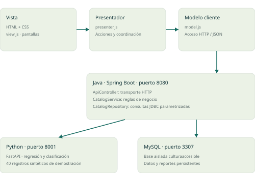
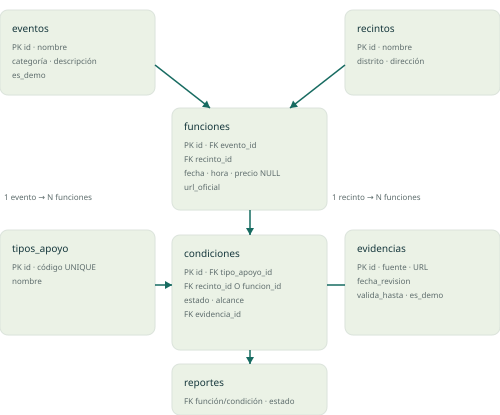
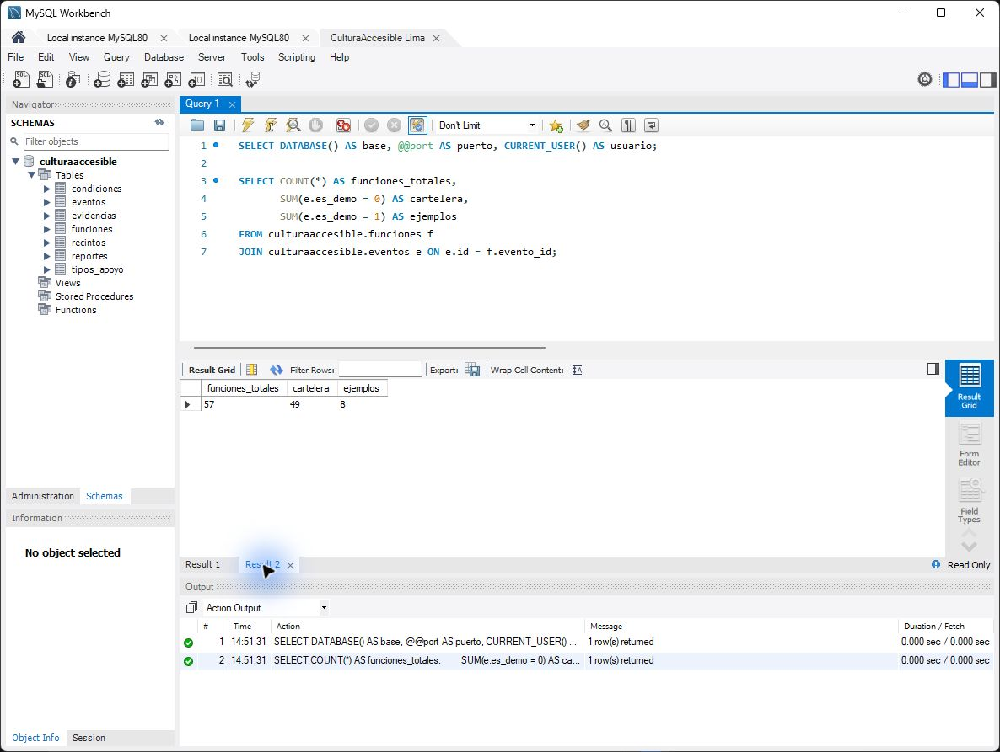
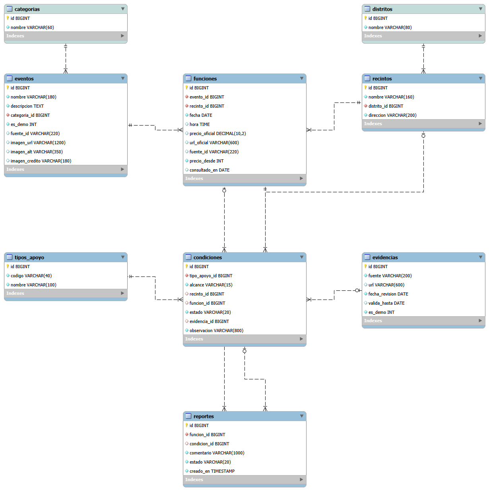

# CulturaAccesible Lima · Informe de Semana 10

Diseño e implementación del PMV1 con Java, Python y MySQL. Actualizado: 18 de octubre de 2026. Curso: Diseño de Productos y Servicios. Sección: 34971. Docente: Jorge Alfredo Guevara Jimenez.

## Alcance y procedencia

Se conserva la propuesta de valor de los trabajos previos: ayudar a personas con necesidades de accesibilidad a comprobar condiciones de eventos culturales de Lima. La implementación local incluye 49 funciones recuperadas de la web del equipo el 17/10/2026 y ocho ejemplos ficticios separados. La PoC Python utiliza datos sintéticos. La web publicada se utilizó como referencia funcional y no fue modificada.

La base de historias suma 10 del APF2 más 2 de IA de la Semana 9: 12. El incremento del 50% agrega 6 y produce 18. Las historias de IA se renumeran HU11 y HU12, conservando su significado. La indicación MVP se entiende como Modelo-Vista-Presentador en la interfaz.

## Roles propuestos

| Rol | Integrante propuesto | Entrega |
|---|---|---|
| Arquitecto de Software | Loreley Itzayana Cruz Gallardo | Diseño, estructura MVP y contratos. |
| Diseñador de BBDD | Roy Kevin Hurtado Pacheco | Modelo, SQL e integridad. |
| Especialista FrontEnd | Celso Eduardo Machuca García | Vista, presentador y accesibilidad. |
| Especialista BackEnd | Eduardo Paco Molina Tapia | Java, conexión MySQL y Python. |
| Ingeniero de Calidad | Esteban Angel Zambrano Canales | Pruebas, evidencias y PDCA. |

Esta distribución es una propuesta; no acredita aportes realizados por cada integrante.

## Arquitectura

Vista: HTML/CSS y view.js. Presentador: presenter.js. Modelo cliente: model.js. Servicios Java: ApiController, CatalogService, CatalogRepository y PricingService. MySQL conserva datos y Python expone la PoC mediante FastAPI.

La guía menciona MVC o hexagonal; se adoptó MVP por la elección comunicada por el equipo. Java usa capas de transporte, negocio y persistencia. Las consultas SQL permanecen en el repositorio y se parametrizan.

## Modelo de datos

Nueve tablas: categorias, distritos, recintos, eventos, funciones, tipos_apoyo, evidencias, condiciones y reportes. Cada evento referencia una categoría y cada recinto un distrito; los nombres únicos evitan repetirlos en esas entidades. Java recupera los nombres mediante JOIN y conserva el contrato de la API. Un CHECK obliga a que la condición se asocie a un recinto o a una función, nunca simultáneamente. Se rechazan precios negativos y estados inválidos. Un precio NULL significa no informado, distinto de cero.

## Selección tecnológica

Escala propuesta 1 a 5; aporte = peso × puntaje / 100. Las calificaciones expresan criterio académico para este equipo, no mediciones de rendimiento ni auditorías independientes.

### IDE

| Factor | Peso | Visual Studio Code | IntelliJ IDEA |
|---|---|---|---|
| Compatibilidad Java/Python | 30% | 5 | 4 |
| Accesibilidad del entorno existente | 20% | 5 | 5 |
| Facilidad de uso | 20% | 4 | 4 |
| Trabajo con Git | 15% | 5 | 5 |
| Recursos del equipo | 15% | 4 | 3 |
| Total | 100% | 4.65 | 4.2 |
Decisión: **Visual Studio Code**.

### Framework Java

| Factor | Peso | Spring Boot | Javalin |
|---|---|---|---|
| Reglas y mantenibilidad | 25% | 5 | 4 |
| Validación y pruebas | 25% | 5 | 3 |
| Integración MySQL | 20% | 5 | 4 |
| Aprendizaje | 20% | 3 | 4 |
| Tiempo inicial | 10% | 3 | 4 |
| Total | 100% | 4.4 | 3.75 |
Decisión: **Spring Boot**.

### Servicio Python

| Factor | Peso | FastAPI | Flask |
|---|---|---|---|
| Validación de entradas | 30% | 5 | 3 |
| Documentación de API | 20% | 5 | 3 |
| Uso con modelos Python | 20% | 5 | 5 |
| Facilidad de implementación | 20% | 4 | 5 |
| Mantenibilidad | 10% | 4 | 4 |
| Total | 100% | 4.7 | 3.9 |
Decisión: **FastAPI**.

### Base de datos

| Factor | Peso | MySQL | PostgreSQL |
|---|---|---|---|
| Instalación disponible | 25% | 5 | 2 |
| Integridad relacional | 25% | 5 | 5 |
| Conexión desde Java/Python | 25% | 5 | 5 |
| Aprendizaje del equipo | 15% | 4 | 4 |
| Accesibilidad para el piloto | 10% | 5 | 5 |
| Total | 100% | 4.85 | 4.1 |
Decisión: **MySQL**.

### Organización

| Factor | Peso | Trello | GitHub Projects |
|---|---|---|---|
| Elección previa del equipo | 30% | 5 | 2 |
| Facilidad del tablero | 25% | 5 | 4 |
| Vinculación con repositorio | 20% | 3 | 5 |
| Acceso para el equipo | 15% | 5 | 5 |
| Claridad de estados | 10% | 5 | 4 |
| Total | 100% | 4.6 | 3.75 |
Decisión: **Trello**.

## Historias de usuario y criterios

### HU01 · Buscar eventos
Etapa: 1. Prioridad: Alta. Estado: **Terminado: verificación técnica local**.

Como visitante, quiero buscar eventos por nombre o disciplina para descubrir actividades que me interesen.

- CA1: Dado un término presente en título, disciplina o recinto, cuando busco, entonces obtengo las funciones coincidentes, ignorando diferencias de tildes y mayúsculas.
- CA2: Dado un término sin coincidencias, cuando busco, entonces aparece un mensaje de cero resultados y puedo limpiar la búsqueda.

Evidencia/pendiente: Java: accentsDoNotBlockSearch, noMatchesReturnsEmpty. Integración 12-14. Navegador.

### HU02 · Combinar filtros
Etapa: 1. Prioridad: Alta. Estado: **Terminado: verificación técnica local**.

Como visitante, quiero filtrar por fecha, distrito, categoría y precio para reducir opciones relevantes.

- CA1: Dado que selecciono varios filtros, cuando busco, entonces cada resultado cumple todos los filtros seleccionados.
- CA2: Dado un precio no informado, cuando filtro ingreso gratuito, entonces esa función queda excluida; al limpiar recupero el catálogo.

Evidencia/pendiente: Java: filtersCombine, unknownPriceIsNotFree, zeroPriceIsFree. Integración 03-04. Navegador.

### HU03 · Abrir ficha por función
Etapa: 1. Prioridad: Alta. Estado: **Terminado: verificación técnica local**.

Como persona con necesidades de accesibilidad, quiero abrir una ficha por función para comprobar apoyos concretos.

- CA1: Dada una tarjeta, cuando la abro, entonces la ficha identifica la misma función, recinto, fecha y hora.
- CA2: Dado que cierro la ficha, cuando regreso al catálogo, entonces se conservan los filtros; un identificador inexistente devuelve 404.

Evidencia/pendiente: Integración 07-09. Navegador: abrir/cerrar y enlace directo.

### HU04 · Estados con fuente y fecha
Etapa: 1. Prioridad: Alta. Estado: **Terminado: verificación técnica local**.

Como visitante, quiero ver Disponible, No disponible o No confirmado con fuente y fecha para saber qué puedo dar por verificado.

- CA1: Dada evidencia vigente y de alcance correcto, cuando abro la ficha, entonces leo estado textual, alcance, fuente y fecha.
- CA2: Dada evidencia ausente, vencida o insuficiente para la función, cuando consulto, entonces el estado es No confirmado, sin inferir disponibilidad.

Evidencia/pendiente: Java: missingEvidenceCannotConfirm, expiredEvidenceCannotConfirm, venueLspDoesNotImplySessionSupport. Integración 07-08.

### HU05 · Navegación accesible
Etapa: 1. Prioridad: Alta. Estado: **En pruebas**.

Como persona que usa teclado o lector de pantalla, quiero recorrer búsqueda y ficha sin ratón para decidir de forma autónoma.

- CA1: Dado el uso de teclado, cuando recorro controles y diálogos, entonces hay etiquetas, foco visible y cierre con Escape que devuelve el foco.
- CA2: Dado el uso de lector de pantalla, cuando cambian los resultados, entonces se anuncia el recuento. Debe probarse con una tecnología de apoyo real antes de cerrar la historia.

Evidencia/pendiente: Revisión parcial en navegador: etiquetas, diálogo y tamaño 390×844. Falta lector de pantalla y auditoría completa.

### HU06 · Consultar un apoyo indispensable
Etapa: 2. Prioridad: Alta. Estado: **Por hacer**.

Como persona que requiere un apoyo, quiero indicar cuál es indispensable y enviar una consulta escrita para obtener respuesta.

- CA1: Dada una función y consentimiento explícito, cuando envío una consulta válida, entonces obtengo un identificador y estado Enviada.
- CA2: Dado que falta consentimiento o contenido obligatorio, cuando envío, entonces se rechaza la consulta sin confirmarla.

Evidencia/pendiente: Criterios propuestos; no hay implementación ni prueba de envío real.

### HU07 · Seguimiento de solicitudes
Etapa: 2. Prioridad: Alta. Estado: **Por hacer**.

Como visitante, quiero consultar el estado y el historial de mi solicitud para no confundir envío con confirmación.

- CA1: Dada una solicitud propia, cuando consulto su historial, entonces aparecen cambios con fecha, responsable y apoyo específico.
- CA2: Dado un envío sin respuesta, cuando reviso, entonces no se muestra como Confirmada; otra persona no puede consultar mi solicitud sin autorización.

Evidencia/pendiente: Criterios propuestos; requiere identidad, permisos y módulo de solicitudes.

### HU08 · Gestión del organizador
Etapa: 2. Prioridad: Alta. Estado: **Por hacer**.

Como organizador, quiero actualizar condiciones por sesión y responder solicitudes para mantener información vigente.

- CA1: Dado un organizador autorizado, cuando actualiza una función o responde, entonces quedan evidencia, fecha y responsable.
- CA2: Dado un usuario sin permiso, cuando intenta editar, entonces se rechaza la operación y no cambia la ficha.

Evidencia/pendiente: Criterios propuestos; no se entrega panel de organizadores.

### HU09 · Preferencias opcionales
Etapa: 3. Prioridad: Media. Estado: **Por hacer**.

Como visitante frecuente, quiero guardar preferencias de forma opcional para encontrar eventos afines más rápido.

- CA1: Dado consentimiento opcional, cuando guardo preferencias funcionales, entonces puedo recuperarlas y modificarlas.
- CA2: Dado que no deseo guardarlas o que las elimino, cuando vuelvo al catálogo, entonces puedo buscar sin registro obligatorio.

Evidencia/pendiente: Criterios propuestos; no se almacenan preferencias ni diagnósticos en esta versión.

### HU10 · Comparar eventos
Etapa: 3. Prioridad: Media. Estado: **Por hacer**.

Como visitante, quiero comparar eventos y recibir explicaciones de coincidencia para elegir con menos esfuerzo.

- CA1: Dadas varias funciones, cuando las comparo, entonces veo diferencias de precio, fecha y apoyos con sus fuentes.
- CA2: Dado un apoyo No confirmado, cuando se explica una coincidencia, entonces la explicación mantiene esa incertidumbre.

Evidencia/pendiente: Criterios propuestos; el filtro de apoyos implementado no equivale al comparador.

### HU11 · Precio orientativo
Etapa: 1. Prioridad: Media. Estado: **Terminado: verificación técnica local**.

Como visitante, quiero consultar un precio orientativo según categoría, distrito y mes para planificar mi presupuesto y verificar la fuente oficial.

- CA1: Dados datos dentro de la cobertura, cuando consulto desde Java, entonces Python devuelve una estimación finita y no negativa con aviso de datos sintéticos.
- CA2: Dado un mes decimal, booleano o fuera de rango, cuando consulto, entonces no se produce una predicción. El precio oficial conserva prioridad.

Evidencia/pendiente: Python: estimación válida y entradas inválidas. Integración 15-19. Nueva PoC, distinta a la del PDF anterior.

### HU12 · Clasificar rango de precio
Etapa: 2. Prioridad: Media. Estado: **Terminado: verificación técnica local**.

Como visitante que explora entradas con un límite de referencia de S/ 40, quiero consultar el rango estimado de un evento sin precio publicado para priorizar la verificación de su precio oficial.

- CA1: Dados datos válidos, cuando solicito orientación, entonces recibo Hasta S/ 40 o Mayor de S/ 40 como clasificación independiente y de demostración.
- CA2: Dado que regresión y clasificación discrepan, cuando se muestran, entonces se advierte la discrepancia y no se garantiza el presupuesto.

Evidencia/pendiente: Python y consulta web. Esta extensión se adelanta como demostración, sin cambiar el alcance original de las etapas.

### HU13 · Filtrar apoyos indispensables
Etapa: 1. Prioridad: Alta. Estado: **Terminado: verificación técnica local**.

Como visitante, quiero filtrar eventos por los apoyos de accesibilidad que considero indispensables para encontrar funciones compatibles con mis necesidades.

- CA1: Dados varios apoyos elegidos, cuando aplico el filtro, entonces cada resultado tiene todos esos apoyos en Disponible para el alcance válido.
- CA2: Dado un apoyo ausente o vencido, cuando filtro por él, entonces la función queda excluida y se informa si no hay coincidencias.

Evidencia/pendiente: Java: supportsRequireAvailable. Integración 05-06. Navegador con filtro LSP.

### HU14 · Compartir una ficha
Etapa: 1. Prioridad: Media. Estado: **Terminado: verificación técnica local**.

Como visitante, quiero compartir un enlace directo a una función y su ficha de accesibilidad para coordinar mi asistencia con un acompañante.

- CA1: Dada una ficha, cuando copio y abro su enlace, entonces se abre la misma función identificada por su ID.
- CA2: Dado que el portapapeles no está disponible, cuando intento copiar, entonces aparece un campo seleccionable con el enlace; se explica que requiere acceso a esta aplicación.

Evidencia/pendiente: Navegador: enlace profundo y recarga. Copia mediante API de portapapeles con alternativa manual.

### HU15 · Reportar información incorrecta
Etapa: 2. Prioridad: Media. Estado: **Terminado: verificación técnica local**.

Como visitante, quiero reportar información de accesibilidad incorrecta o desactualizada para que el equipo pueda revisarla.

- CA1: Dado un comentario válido, cuando envío el reporte, entonces MySQL lo guarda con identificador y estado Pendiente.
- CA2: Dado un comentario inválido o fallo de persistencia, cuando envío, entonces no aparece confirmación de guardado; el reporte no modifica automáticamente la ficha.

Evidencia/pendiente: Integración 20-22 y consulta directa a MySQL. Reporte de prueba visible en navegador.

### HU16 · Revisar evidencias
Etapa: 2. Prioridad: Alta. Estado: **Por hacer**.

Como revisor de la plataforma, quiero comprobar las evidencias de cada condición antes de aprobar su publicación para mantener información confiable.

- CA1: Dado un revisor autorizado y evidencia suficiente, cuando aprueba una condición, entonces se registran responsable, fecha, alcance y resultado.
- CA2: Dada evidencia insuficiente o permiso ausente, cuando se intenta aprobar, entonces la condición no se publica como Disponible.

Evidencia/pendiente: Criterios propuestos. La degradación automática de estados sí funciona; el flujo de aprobación con permisos queda pendiente.

### HU17 · Avisos de cambios
Etapa: 3. Prioridad: Media. Estado: **Por hacer**.

Como visitante, quiero recibir avisos de cambios de fecha, cancelación o apoyos de una función que sigo para reorganizar mi visita.

- CA1: Dada una suscripción consentida, cuando cambia información relevante de la función, entonces recibo un aviso que identifica el cambio.
- CA2: Dado que retiro mi suscripción, cuando ocurre otro cambio, entonces no se envía una nueva notificación.

Evidencia/pendiente: Criterios propuestos; no se envían correos, mensajes ni notificaciones en esta entrega.

### HU18 · Búsqueda en lenguaje natural limitado
Etapa: 1. Prioridad: Media. Estado: **Terminado: reglas limitadas verificadas**.

Como visitante, quiero consultar el catálogo mediante lenguaje natural para encontrar eventos sin conocer todos los filtros disponibles.

- CA1: Dada una frase con categorías, distritos o apoyos reconocidos, cuando la envío, entonces se proponen filtros visibles que puedo cambiar.
- CA2: Dada una frase sin filtros reconocidos, cuando la envío, entonces se explica el límite y se permite usar la búsqueda manual sin inventar eventos.

Evidencia/pendiente: Navegador: Teatro en Miraflores con LSP. Implementación por reglas, sin IA generativa ni comprensión general del lenguaje.

## Implementación y ejecución

El catálogo Java consulta MySQL; el frontend consume JSON mediante el modelo cliente y el presentador actualiza la vista. Las respuestas obsoletas se descartan y las búsquedas anteriores se cancelan. La ficha tiene enlace por ID. Los reportes se insertan con estado PENDIENTE y no alteran automáticamente las condiciones. La estimación Python se solicita a través de Java; errores de entrada, ausencia de cobertura y caída del servicio tienen respuesta comprensible.

AccesI utiliza TF-IDF y regresión logística para reconocer intenciones, más reglas para aplicar fechas, precios y apoyos sobre el catálogo leído desde MySQL. Conserva filtros durante la conversación, responde a saludos y no usa un proveedor generativo externo. No se afirma comprensión ilimitada ni precisión medida en conversaciones reales.

## Resultados técnicos

- Java: 20 pruebas aprobadas.
- Python: 43 pruebas aprobadas.
- Fallos controlados de servicios: 4 pruebas aprobadas.
- Migración, integridad e instalación: 9 pruebas aprobadas.
- Integración real: 39 pruebas; fallos 0; errores 0.

Nueva PoC sintética: MAE S/ 3.427; accuracy 0.9; F1 clase hasta S/ 40: 0.909. Se utilizan 30 registros de entrenamiento y 10 de prueba, con semilla 42. No se ha realizado selección comparativa de modelos en esta implementación; se mantienen dos modelos académicos predefinidos. Estas métricas no equivalen a validación sobre eventos reales.

## Ciclo PDCA aplicado

| Planificar | Hacer | Verificar | Actuar |
|---|---|---|---|
| Evitar estados confiables sin respaldo vigente. | Degradar datos ausentes, vencidos o de alcance incorrecto a No confirmado. | Pruebas Java y filtros LSP en los ejemplos. | Mantener casos de regresión. |
| Evitar aceptar 6.5 como mes entero. | Rechazar coerción de decimales y escalares en Java; StrictInt en Python. | Integración 16-18 y casos Python. | Conservar validación en ambos límites de API. |
| Explicar desacuerdo de regresión y clasificación. | Añadir bandera models_disagree y aviso visible. | Navegador: Danza/Miraflores/octubre produce S/ 49.98 y clase Hasta S/ 40 con advertencia. | Verificar precio oficial y mejorar datos antes de uso real. |
| Cargar SQL con punto y coma dentro de textos. | Ejecutar sentencias múltiples mediante el controlador y hacer la semilla idempotente. | Inicialización y recarga sin duplicados. | Conservar script reproducible y pruebas de integridad. |

## Organización y Git

Trello creado el 18/10/2026: https://trello.com/b/ykyaVYXr/culturaaccesible-lima-semana-10. Contiene 18 tarjetas con historia, prioridad, etapa, criterios y evidencia: 7 Por hacer, 0 En desarrollo, 1 En pruebas y 10 Terminado. El repositorio privado con historial está publicado en https://github.com/roykevinh9-boop/culturaaccesible-lima. La revisión mediante pull request sigue pendiente. Los enlaces requieren acceso autorizado.

## Instalación

Ejecutar Abrir-demo.cmd con Java 17+, Python 3.11/3.12 y MySQL Server 8.0.16+. La primera ejecución necesita Internet para las dependencias. La demo utiliza MySQL aislado en 3307, Python 8001 y Java 8080. Las credenciales aleatorias y los datos quedan en .local, excluidos del paquete. Mantener abierta la ventana; Ctrl+C detiene los componentes. La sección de instalación explica cómo iniciar, compilar y probar. Los archivos de lectura inicial se retiraron a petición del equipo.

## Límites y siguientes pasos

Pendientes: autenticación y permisos, solicitudes reales, panel organizador, revisión por responsables, notificaciones, preferencias, comparación, catálogo real revisado y auditoría completa de accesibilidad. La revisión móvil y del teclado no certifica conformidad WCAG. Se requiere prueba con lectores de pantalla y con personas usuarias.

## Referencias y material de base

- Equipo CulturaAccesible Lima. APF2, semana 8, apartados 2.3 y 2.4, páginas 13-18. Historias originales y alcance por etapas.
- Equipo CulturaAccesible Lima. Actividad 06, página 4. Propuesta de valor y condiciones verificables.
- Equipo CulturaAccesible Lima. Informe semana 9, páginas 2 y 13. Historias de estimación y clasificación; PoC previa.
- Guía de trabajo 10, páginas 1 y 8. Entregables de diseño, implementación y PDCA.
- Sitio del equipo: https://culturaaccesible-lima-mvp1.dag126.chatgpt.site/
- Spring: https://spring.io/guides/gs/accessing-data-mysql/
- FastAPI: https://fastapi.tiangolo.com/tutorial/first-steps/
- MySQL: https://dev.mysql.com/doc/refman/8.0/en/create-table-check-constraints.html
- scikit-learn: https://scikit-learn.org/stable/modules/model_evaluation.html

Los resultados técnicos corresponden a ejecución local de esta sesión. No se inventan entrevistas, confirmaciones de organizadores, publicaciones remotas ni aportes personales.

## Conexión MySQL Workbench verificada el 18/10/2026

La conexión CulturaAccesible Lima quedó guardada y abierta en MySQL Workbench. Se comprobaron mediante SELECT la base culturaaccesible, el puerto 3307 y el usuario cal_app@127.0.0.1. La captura de Workbench documenta las siete tablas anteriores a la normalización; la versión actual tiene nueve tablas, verificadas mediante SQL y pruebas de migración. El recuento devolvió 57 funciones: 49 de cartelera y ocho ejemplos ficticios. La página también respondió con estado ok y 49 funciones de cartelera.

Las credenciales se introdujeron localmente y no se incluyen en el informe ni en el paquete. La cartelera conserva su fecha de recuperación, 17/10/2026; la verificación de conexión no equivale a una actualización de sus fuentes.

Evidencias: mysql-workbench.json, mysql-workbench-conexion.jpg y mysql-workbench-datos.jpg.

## Normalización de base de datos · versión 1.3

Se agregan categorias y distritos, con nombres únicos. eventos.categoria_id y recintos.distrito_id son claves foráneas obligatorias. Los textos anteriores se trasladaron a los catálogos y se retiraron las columnas duplicadas. La API conserva los nombres mediante JOIN, sin modificar la interfaz ni la IA.

Se guardó un respaldo SQL privado en .local/backups antes de modificar la estructura. El hash de la representación lógica coincide antes y después: se conservaron 6 recintos, 57 eventos, 57 funciones, 7 apoyos, 271 evidencias, 288 condiciones y los 5 reportes que existían. Las pruebas de integración posteriores agregan un reporte identificado como prueba.

Se aprobaron nueve pruebas nuevas en bases efímeras propias: conservación, repetición, ausencia de huérfanos, categoría adicional, claves foráneas, nombres únicos, instalación desde esquema/semilla/importador, CHECK de accesibilidad y carga del SQL completo. Total de esta entrega: 115 pruebas aprobadas.

docs/CulturaAccesibleLima.mwb es el modelo editable con nueve tablas y diez relaciones. database/CulturaAccesibleLima.sql instala una base nueva con 49 funciones recuperadas y ocho ejemplos; excluye reportes privados. 04_normalizar_catalogos.sql adapta una base previa y puede repetirse. Las historias y la arquitectura MVP se mantienen.

## Anexo: diagrama físico de Workbench

La imagen corresponde al modelo editable CulturaAccesibleLima.mwb. Sus tablas y columnas se contrastaron con la base activa. Categorías y distritos se referencian desde eventos y recintos, respectivamente.