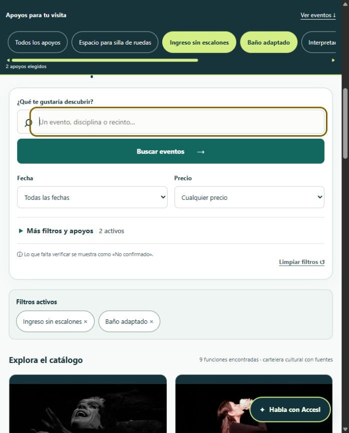
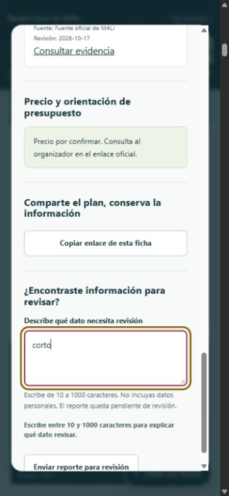
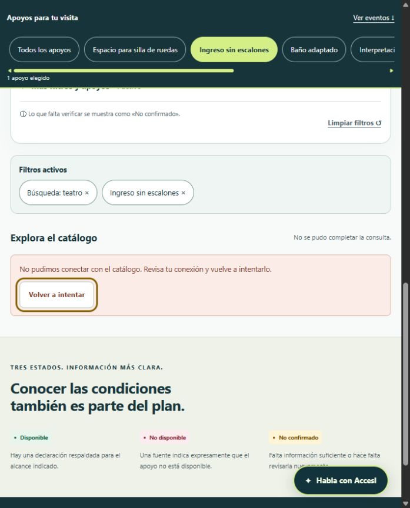

# Revisión de los diez principios UX del MVP1

Revisión técnica del 25/10/2026 sobre la mejora de filtros, control, errores, teclado y consultas del catálogo. Los escenarios fueron ejecutados por el agente en un navegador contra Java, Python y MySQL locales. No participaron personas reclutadas ni se ejecutó un lector de pantalla.

## Rúbrica y resultado

Se conserva la escala anterior: 0 = sin evidencia; 1 = incipiente; 2 = parcial; 3 = funcional con pendientes; 4 = consistente y documentado en los escenarios inspeccionados. Índice = puntos / 40 × 100. El máximo de un criterio se limita a este alcance técnico; no significa perfección ni conformidad WCAG completa.

| Principio | Antes | Ahora | Evidencia y límite |
|---|---:|---:|---|
| Usabilidad | 3 | 3 | Búsqueda, ficha y chat comprobados; falta medir éxito y esfuerzo con participantes. |
| Accesibilidad | 2 | 3 | Salto al catálogo, foco inicial y retorno, 30 pasos Tab/Mayús+Tab dentro del chat, campos etiquetados, texto al 125 % y revisión de anchos móviles. Falta lector de pantalla real y evaluación completa. |
| Simplicidad | 3 | 4 | Fecha y precio visibles; opciones adicionales desplegables; selecciones visibles aunque el panel esté cerrado. |
| Consistencia | 4 | 4 | Se conservan estilos, etiquetas de estados y vocabulario común; contador singular/plural y pie de semana actualizados. |
| Jerarquía visual | 3 | 3 | Acciones, filtros y resultados diferenciados; comprensión pendiente con personas. |
| Feedback inmediato | 3 | 4 | Espera limitada, errores de campo en español, conexión interrumpida y reintento visible; las escrituras no se reenvían automáticamente. |
| Control del usuario | 3 | 4 | Quitar filtros individuales, deshacer limpieza, conservar la búsqueda tras un fallo y volver al botón de origen al cerrar la ficha. |
| Eficiencia y fluidez | 3 | 4 | Tres llamadas de persistencia por búsqueda, probadas con 1, 57 y 250 funciones; comparación local con el JAR previo y mismas respuestas. |
| Diseño centrado en el usuario | 2 | 2 | Los casos simulados aportan cobertura de tareas e hipótesis; falta evidencia de interacción con participantes reales. |
| Diseño iterativo | 4 | 4 | Se detectaron y corrigieron problemas de transporte y foco durante la revisión; se conservan pruebas de regresión. |
| **Total** | **30 / 40** | **35 / 40** | **75 % → 87,5 %, equivalente a 88 % al redondear al entero.** |

El resultado es una autoevaluación técnica, no una nota del docente ni una medición de satisfacción. No se incrementa el criterio de investigación con usuarios por ejecutar simulaciones.

## Escenarios ejecutados en navegador

| Caso | Acción y resultado observado |
|---|---|
| UX01 | Estado inicial: fecha y precio visibles; opciones adicionales cerradas. Catálogo oficial: 49 funciones. |
| UX02 | Elegir ingreso sin escalones y baño adaptado: nueve funciones, dos etiquetas y selección sincronizada. |
| UX03 | Limpiar y deshacer: se recuperan ambos apoyos y las nueve funciones. |
| UX04 | Quitar un apoyo desde su etiqueta: se conserva el otro y el foco pasa a un control disponible. |
| UX05 | Abrir ficha: foco en su título; Escape devuelve el foco al botón de la tarjeta y conserva apoyos. |
| UX06 | Enviar «corto» como comentario: aviso junto al campo, aria-invalid y aria-describedby; texto conservado y sin envío. |
| UX07 | AccesI responde a «Hola» enviado con Enter. Escape devuelve el foco al acceso al chat. |
| UX08 | Treinta pasos de Tab y Mayús+Tab permanecen dentro del chat tras corregir el recorrido de foco. |
| UX09 | Ventanas solicitadas de 390 y 320 píxeles: anchos de contenido 375 y 305; sin desbordamiento horizontal. Ficha y chat también caben. |
| UX10 | Los controles de formulario visibles tienen etiqueta; el tamaño del texto al 125 % no produce desbordamiento en la revisión. |
| UX11 | Con el servidor detenido, la consulta informa del fallo y conserva «teatro» y sus filtros. Tras reiniciar, «Volver a intentar» recupera 40 funciones sin reescribir la consulta. |

[Registro de navegador](evidencias/ux-2026-10-25/browser-checks.json).

## Eficiencia y conservación de datos

La versión anterior realizaba 116 llamadas al puerto de persistencia para 57 funciones: 2 + 2 × N. El cálculo procede del código del commit 5311c00. La nueva versión realiza tres: tipos de apoyo, condiciones en bloque y funciones. Las pruebas del servicio verifican ese límite con diferentes tamaños del catálogo. No se añade una caché que pueda conservar evidencia vencida.

El procedimiento nuevo `cal_catalog_conditions` es de lectura y conserva el orden de precedencia de función sobre recinto. Se mantienen las cinco rutinas anteriores. La prueba MySQL compara la salida en bloque con la rutina individual para las ocho funciones de ejemplo.

En siete muestras por versión, con calentamiento y la misma base local, la mediana pasó de **173,52 ms a 27,41 ms**. Las respuestas de los catálogos oficial, ficticio y completo coincidieron entre ambos JAR. Esta comparación describe este equipo, no el rendimiento de un futuro alojamiento público.

[Mediciones y método](evidencias/ux-2026-10-25/performance.json).

## Verificación automatizada

Se aprobaron **156 casos distintos**: 34 Java, 16 JavaScript, 43 Python, 39 de integración HTTP, 9 de migración/instalación, 11 de procedimientos y 4 de fallos controlados. Los escenarios de navegador anteriores se registran aparte. La recompilación final incorpora la interfaz al JAR; el arranque normal y el reintento se comprobaron después.

[Resumen de pruebas y puntuación](evidencias/ux-2026-10-25/review.json).

## Referencias de evaluación

- [W3C: funcionamiento por teclado](https://www.w3.org/WAI/WCAG22/Understanding/keyboard.html).
- [W3C: mensajes de resultado y errores de formulario](https://www.w3.org/WAI/tutorials/forms/notifications/).
- [W3C: participación de usuarios en la evaluación](https://www.w3.org/WAI/test-evaluate/involving-users/).

Las referencias orientan las comprobaciones. La rúbrica porcentual es propia del informe del equipo.
